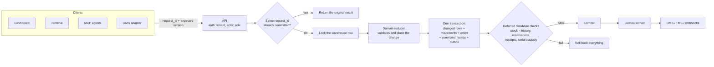

# Warehouse execution boundaries

## The big picture

Every client (the browser dashboard, the warehouse terminal, AI agents over MCP, and the OMS) sends the same canonical commands to one API. Each command runs in a single PostgreSQL transaction that writes the business change, its immutable history and its outgoing messages together. The database itself refuses to commit anything whose history doesn't add up.

**Four ideas carry the whole design:**

1. **History is the source of truth.** Balances are caches of an append-only movement ledger. `GET /v1/warehouses/{id}/reconciliation` rebuilds them from scratch, independently of the cached rows.
2. **The database enforces the rules, not just the application.** Deferred constraint triggers re-check each commit, so a bug in the API, or a direct SQL write, can't leave inventory inconsistent.
3. **Every write is retry-safe.** A `request_id` is bound to its actor and exact payload. Retrying after a lost response returns the stored result; it never applies the change twice.
4. **Nothing is guessed.** Quantities are whole units, labels are kept exactly as scanned, and missing or ambiguous evidence blocks work instead of being filled in.

**Where to find each part:**

| Concern | Code |
|---|---|
| HTTP routes, authentication, headers | `src/api.rs`, `src/auth.rs` |
| Entity types, the `Command` enum and state helpers | `src/domain.rs` |
| The command reducer, validation and demo data | `src/domain/apply.rs`, `src/domain/validate.rs`, `src/domain/demo.rs` |
| Transaction, locking, receipts, migrations, reconciliation | `src/persistence.rs` (reads, receipts, reconciliation, outbox), `src/persistence/` (`startup.rs` migrations and provisioning, `load.rs`, `save.rs`, `execute.rs` command execution), `src/store.rs` |
| Resource versions (which concurrent writes conflict) | `src/concurrency.rs` |
| Serial tracking | `src/serials.rs`, `src/serials/equations.rs` (custody equations), `src/serial_*.rs`, `migrations/021`–`035`; see the [serial design guide](serial-design.md) |
| Lots, expiry, quarantine and lot tracing | `src/lot_control.rs`, `src/lot_store.rs`, `src/lot_trace.rs` |
| Transfers, packages, returns, receipts, shipments | `src/transfers.rs`, `src/split_fulfillment.rs`, `src/returns.rs`, `src/receipts.rs`, `src/shipments.rs` |
| Outbox delivery and integrations | `src/integrations.rs`, `src/native*.rs`, `src/oms_*.rs` |
| Planning (putaway, batch picking, cycle counts, replenishment) | `src/putaway.rs`, `src/batch_pick.rs`, `src/cycle_counts.rs`, `src/replenishment.rs` |
| Labels, carrier labels, GS1 scanning, GTINs and bin capacity | `src/labels.rs`, `src/carrier_labels.rs`, `src/gs1.rs`, `src/master_data.rs` |
| MCP server | `src/mcp.rs` |
| Schema and database guards | `migrations/` (append-only; digests checked at startup; a database migrated by a newer release is refused) |
| Current definition of every database function and trigger | `schema/current-functions.sql` (generated; drift-checked by `tests/sql_catalog.rs`) |
| Dashboard | `dashboard/src/App.tsx` (shell, routing, session and journal), one component per tab (`*Tab.tsx`), the order, receipt and help dialogs (`OrderDetail.tsx`, `ReceiptDetail.tsx`, `WorkspaceGuide.tsx`), `PlanningPanels.tsx` |
| Fast tests without a database | `tests/domain.rs`, `tests/planning_units.rs` |

The sections below are the detailed contract.

## Source evidence and ownership

`stateset-sync-server` is the OMS. It owns commercial orders and orchestration. `src/domain/warehouse_os.rs` and `src/services/warehouseos.rs` show its existing WarehouseOS adapter; this is a third-party contract, not an existing native StateSet WMS connector.

`stateset-warehouse` is the WMS. It owns the physical warehouse ledger, location balances, reservations, receipt execution, and pick/pack/handoff evidence. Its balances are authoritative for warehouses explicitly managed here. Do not also mutate those warehouses in iCommerce or WarehouseOS. An OMS copy of availability must be a projection, not an independent writer.

`stateset-freight` is the TMS. `src/integrations.rs` and `src/domain.rs` implement transportation, carrier procurement, stops, tracking and Sync writeback. This WMS records the physical handoff; a freight dispatch or delivery event does not authorize it to ship inventory a second time.

`stateset-edi/src/transactions/receipt944.rs`, `adjustment947.rs`, and the warehouse lifecycle in `src/lifecycle.rs` establish document responsibilities. EDI owns X12 parsing/transport. This repository emits warehouse events and does not implement another EDI parser.

`next-temporal-rs/crates/engine-workflows` supplies existing durable orchestration. The WMS does not need a Temporal worker to commit a local stock movement. Cross-service orchestration can consume its durable events.

`stateset-app/package.json` establishes React and TypeScript UI conventions; the newer EDI/Sync/engine dashboards establish React/Vite. The WMS uses Rust 1.90, Axum 0.8, Tokio, SQLx/Postgres and React/TypeScript/Vite.

iCommerce's `crates/stateset-core/src/models/warehouse.rs` and `crates/stateset-db/src/postgres/warehouse.rs` provide warehouse design references. Its `crates/stateset-migrations/migrations/080_reservation_order_line.sql`, `083_inventory_balance_guards.sql` and `092_inventory_balance_identity.sql` establish reservation ownership and balance identity/protection. The `postgres_inventory_oversell.rs`, `postgres_move_inventory_concurrency.rs` and shipment atomicity cases provide regression inputs. The WMS in version 0.2.0 also compiles pinned `stateset-core` and `stateset-primitives` crates for typed interoperability, upstream validation and read-only inventory projections. The [compatibility adapter](icommerce.md) preserves explicit IDs and exact whole-each semantics. The WMS retains its own execution logic, PostgreSQL schema and physical ledger; no iCommerce database engine or second inventory writer is introduced. Sync and Freight connect through the explicit [HTTP adapters](native-integrations.md).

## Inventory contract

Quantities are whole **each** units, bounded to 1,000,000 per operation and 1,000,000,000 per bin/lot. Fractional measured quantities are unsupported and rejected rather than rounded. Reviewed whole case, inner-pack and pallet inputs retain the original definition ID and exact each conversion; later factor changes never reinterpret earlier requests. Stock identity is `(warehouse, location, SKU, lot)`. Lot is a required explicit string (`UNTRACKED` is allowed); serial command admission is locally software qualified as described below; lot expiry and independent quarantine are governed by the immutable policy history described below.

Physical stock includes receiving, storage and staging. Receiving increases physical stock into a receiving bin; putaway transfers it into storage without changing the warehouse total. Allocation reserves only eligible storage stock in earliest-known-expiry order, then stable location/lot order; optional unlabelled lots follow known expiry. Each allocation is keyed to an immutable order-line ID. Picking moves reserved units into the staging bin and preserves their reservation. Shipping removes those staged units only after packing, with a recorded carrier and handoff reference. TMS remains responsible for transportation after handoff.

Each transition checks quantities and legal state. Partial receipts, picks and shipments persist. The original whole-order packing path remains available; package mode allocates available stock and retains remaining demand, then packs and hands off exact picked allocation tuples independently. Whole-order cancellation releases reservations before picking. After a partial handoff, explicit remainder cancellation closes remaining demand only after unpacking and actual staged-stock recovery. A short pick can open a blocking exception. Recovery returns physically verified staged units to their original line/bin/lot, releases allocations only after every staged unit is returned, records a physical count, resolves the exception and allocates again. Returning packed units invalidates packing. Recovery remains available while an exception blocks forward execution; resolving an exception alone never changes quantities.

Every stock change creates a movement. Independent reconciliation reconstructs each physical balance from movement endpoints and reservations from exact line allocations. Opening stock requires a receipt or a reasoned physical count; it is never an invisible initial balance. Every receipt movement also identifies the exact receipt and line, so another receipt for the same SKU/lot cannot borrow its evidence. Counts reject stale versions and observed quantities below existing reservations.

## Persistence and concurrency

The warehouse head contains facility metadata and a version. Products, locations, stock, orders, order lines, allocation ownership, receipts, receipt lines and exceptions occupy indexed relational tables. Entity JSON preserves the API representation while normalized execution columns enforce quantities, identities and foreign keys. Movements and activity are append-only rows. The command path writes changed entities and new evidence; it does not rewrite accumulated warehouse history.

A row lock on the warehouse head serializes that warehouse's writes across API processes. The changed operational rows, movement/reservation evidence, event, actor-bound command receipt and destination outbox intents commit together. Deferred PostgreSQL constraints reject stock/ledger, reservation/allocation and received/exact-line evidence mismatches at commit. Immutable history cannot be updated or deleted. A final outbox failure rolls the entire command back. Commands without resource reviews retain the strict warehouse-version fence. Reviewed physical commands instead require exact database-owned revisions for their touched stock, order/receipt, product/location metadata and allocation inventory; unrelated global changes can proceed. Revisions also fence changed-and-restored balances and order exceptions. Exact successful request retries read immutable actor/payload-bound receipts without the warehouse writer lock, with a second locked lookup for racing first submissions. A strictly older expected version receives definitive non-commit evidence only after this locked receipt lookup. That evidence binds the original actor, tenant, warehouse and request; a future version or ordinary conflict cannot release a browser recovery journal. Canonical detail reads are bound to the reviewed warehouse version so newer snapshots invalidate stale detail actions.

Operational reads use a consistent transaction snapshot. They include active work, bounded recently completed work and at most 100 recent movement/activity records, with the receipt evidence needed to validate those movements. Older records remain accessible through keyset history pages and authoritative order/receipt details. The full reconciliation endpoint recomputes balances from every immutable movement and exact allocation, independently of the operational ledger caches; it also compares received quantities with all exact receipt-line movements.

The operational response serializes its typed state directly. One ordered proof accumulation combines physical evidence, exact allocation ownership and actual stock; those same rows determine the reconciliation flag and response body. Structural validation indexes product/location identities instead of rescanning their vectors for each reference. Invalid stored state still returns its diagnostic proof with `ok: false`. This changes neither the public JSON fields nor the independent full-history SQL reconciliation, and introduces no version-based snapshot cache.

Scoped physical commands load only their SKUs and owning order or receipt while holding the same warehouse lock. They reconstruct the owner's normalized children and exact receipt evidence, load the selected SKUs' physical ledger, and aggregate other orders' source and staging holds directly from normalized allocations. This internal reservation baseline is neither accepted from JSON nor exposed to clients. The ordinary reducer verifies the combined ownership and physical balances before the normal changed-row transaction; deferred database proofs remain in force. Global-version commands and unsupported scoped operations retain the full loader. Public snapshots and independent full-history reconciliation still cover the complete warehouse.

Tracked migrations import validated legacy snapshots and fence old aggregate writers while retaining the original snapshot. Ambiguous legacy receipt evidence blocks migration rather than inventing a line association. The former 8 MiB aggregate ceiling is removed; a retained-history test exceeds it without blocking subsequent commands. Writes serialize per warehouse and active-work size matters. Keyed in-memory joins and changed-entity comparisons avoid repeated scans without weakening the warehouse lock or database constraints. The [measured workload profiles](performance.md) retain baseline and optimized results with independent correctness totals; production capacity still needs the facility workload.

All production data is tenant-scoped. API credentials or verified WorkOS memberships map server-side to tenant, actor and role; client-supplied tenant/actor values are not trusted. Operators execute work; admins also manage catalog/locations and adjustments; OMS credentials submit/cancel fulfillment requests only. Demo mode is explicit, uses a separate tenant, synthetic records, and Postgres persistence. Real mode starts empty and requires strong configured keys or explicit [WorkOS organization and role mappings](authentication.md).

The native [MCP endpoint](mcp.md) is a stateless HTTP adapter around the same business routes. Outer authentication binds the current request identity; tools cannot supply an actor, tenant or remote URL. Typed command schemas retain the complete original REST envelope and its version/resource fences. The adapter dispatches internally through canonical handlers and returns their original body/status, including conflict evidence. It adds no direct database writes, automatic physical confirmation, version refresh or generated retry keys. Tool discovery is role-aware; execution still checks server permissions. Fixed host/origin and body limits apply to the MCP transport.

Admins create additional facilities through the ordinary command path. In one transaction, a unique warehouse-header insertion serializes competing admission, the usual locked receipt lookup resolves racing identical requests, and the version-1 creation saves default receiving/staging bins, activity, event, receipt and delivery intent. A final failure rolls back the header too. Existing facilities cannot be recreated. Facility creation changes no other warehouse's version or inventory; catalogs, locations, receipts and orders remain warehouse-scoped. The directory uses tenant-leading keyset pagination rather than hiding facilities after 100 rows.

The browser remembers the selected warehouse per tenant/actor. It restores an unresolved physical or native request's original warehouse ahead of that preference. A creation lost before arrival can retain its new URI while the browser displays an existing workspace. Switching holds while either journal is unresolved; accepted switches advance the UI epoch, abort old reads, clear modal/detail/history/proof state and remount scanner/native workspaces. Responses must identify the requested warehouse. Visible facility code/city remains available on mobile, and repeated directory labels gain an ID suffix. Switching does not transfer stock between facilities.

Tenant-wide operations summaries run in a separate read-only repeatable-read transaction, with bounded execution and tenant-leading indexes. They expose queue age/lease state, uncertain native requests and open exceptions without loading retained business payloads. A fixed-cardinality administrator metrics endpoint supports the same observations. The dashboard marks offline, failed and expired snapshots stale and prevents exporting them as current evidence. These observations complement the independent inventory proof; queue emptiness alone does not certify warehouse health.

## Original shipment evidence

Each full-order handoff records one immutable source document from its original committed event, in the same transaction as stock, physical movements, command receipt and outbox. The document retains every typed order header field, exact order lines and source bin/lot allocation ownership. SQL independently compares it to canonical normalized rows and actual outbound `STAGE-01` movements. Shipped business metadata/ownership cannot be edited, extra outbound movements are rejected, and expected order-line identities/quantities are immutable from creation. Warehouse-head serialization also rejects repeatable-read edits whose snapshot predates the handoff. A many-lot shipment performs its full proof once on recording and once at commit; row guards do not repeat the complete JSON proof per allocation.

Returns, eligibility and conditional OMS fulfillment share this source. Their caps and payloads cannot expand merely because a later operational row changes. Full reconciliation includes every source and completed order, including archived ones. Cached order JSON children remain replaceable projections and cannot change the facts. Forensic guard bypass still leaves independent read-side checks that hold authorization/writeback and expose the disagreement.

Upgrade admission preserves a unique original scoped event or exact retained legacy snapshot and rejects missing, ambiguous or changed provenance. Existing disclosed demo shipments receive an explicitly synthetic baseline backed by their immutable fixture activity. Legacy and synthetic records never become physical events or qualify conditional OMS send. Actual legacy Store import verifies the retained source after normalization. All provenance classes remain visible in return review and the full proof.

## Customer returns and replenishment

Customer return authorization creates a normal receipt with immutable normalized ownership of its original shipped order, exact order line and lot. Allowance counts all retained RMAs rather than only the dashboard window. The source SKU is derived from the shipped line. Authorization changes no physical stock; receiving and putaway use the existing movement and exact receipt-line proof. PostgreSQL independently checks return caps, including competing repeatable-read SQL transactions; source ownership reconstructs from normalized rows even when cached JSON is malformed. Full reconciliation compares shipped, authorized and received quantities. Original shipment/OMS evidence stays intact; refunds and quality-disposition automation are not implemented.

Receipt-line identities, SKU/lot and expected quantities are immutable from creation. Receipt cancellation additionally freezes the exact received and unreceived quantity of every line in immutable normalized tables. The receipt becomes terminal; received stock remains available for ordinary inspection/putaway. Deferred PostgreSQL proofs compare terminal status, every frozen identity/quantity and live receipt evidence, and serialize direct SQL against the warehouse head. Cancelling a partial RMA releases only its unreceived original line/lot allowance. All-history SQL authorization/reconciliation subtracts those immutable quantities even after the RMA leaves dashboard history. Deferred checks require every RMA receipt line to match its original immutable authorization; the upgrade preflight rejects existing normalized quantity/ownership drift rather than inventing an allowance. The public command, audit activity, self-contained cancellation event, immutable command result and outbox intent commit together; a final delivery-intent failure rolls everything back. Cancellation uses a strict warehouse-version review; previous resource-scoped receive reviews are invalidated by the receipt revision.

Pick-face replenishment is an explicit operator plan over one consistent inventory snapshot. Minimum/target rules select unreserved storage, optionally restrict a reserve zone, protect every configured pick-face destination and spend each source bucket at most once across rules. Virtual destination balances also prevent exceeding the per-bin/lot quantity ceiling; another eligible lot can supply the remaining demand. Plans expose unfilled demand, reserve nothing and carry the exact resource review for normal physical move confirmation. The UI replans after each confirmed movement. Rules are supplied per plan rather than a background scheduler.

## Cross-service delivery

Schema-version 2 event envelopes carry event identity, tenant, warehouse, actor, time, command and committed version. `inventory_changes` contains absolute snapshots of only the bin/lot balances changed by that command, each tagged with its version. It is not a complete warehouse projection. Consumers deduplicate event IDs and version each bin/lot independently: an older event may contain a change to a different bin that a newer event did not include. Per-order business effects also require their own retained identity and reconciliation.

Every command queues an optional OMS event; packed and shipped orders also queue optional TMS events. A leased worker reuses the event ID as its idempotency key and retains attempt outcomes, expired-lease uncertainty, bounded retries and dead letters. Every claimed attempt consumes the automatic budget, including a sender that crashes before its outcome is committed. An expired eighth attempt retires into a dead letter without another POST. Clearing the retired lease token fences late completions; audited administrator requeue preserves the event and prior attempts. Generic webhook destinations require compatible consumers. They do not reinterpret an existing Sync or Freight endpoint. HTTP acceptance does not establish downstream execution. EDI 944/945/947 generation remains the EDI gateway's responsibility.

Native adapters separately use Sync's tenant-scoped order API and Freight's `/v1/sync/import` API, grounded in their checked-in implementations. Imports validate a reviewed source revision, source status, exact quantities and stable line identities. A complete native source has one owner across the WMS tenant's warehouses, including commands using the native source prefix; warehouse-assigned splitting needs an explicit OMS assignment contract. Original response envelopes and translated commands are frozen in an actor-bound journal before warehouse execution. A retry can recover the normal command receipt after a crash between the warehouse commit and journal completion.

Transportation requires a packed order, no blocking exception, a verified source and an explicit operator-supplied transport plan. The request and source evidence are retained before remote HTTP. A lease permits one sender; retries reuse the same frozen plan and remote idempotency key, and preserve uncertain outcomes after a timeout or crash. No database lock spans the HTTP call. Freight acceptance means a planned load, not pickup, dispatch or delivery. Native request identities and completed receipts are protected from mutation by database triggers.

The legacy Sync fulfillment endpoint remains held because it lacks a conditional revision and terminal-state fence. The included companion receiver enforces those predicates, exact full-order source lines and immutable accepted/rejected receipts under the OMS order-row lock. WMS conditional writeback is explicitly opt-in after that companion is deployed and qualified. The WMS compares the original immutable shipment event with normalized allocation evidence before freezing a tenant/recipient/revision-bound request; its retries preserve that exact request after source changes. Unknown outcomes retain exclusive shipment ownership. A validated durable rejection permits an explicit newly reviewed intent while preserving the physical event and old receipt. See [the native contracts](native-integrations.md) and [companion patch](../integrations/stateset-sync-server/README.md).

## Evidence and assumptions

No production scans, physical counts, facility layout or operator observations were provided. The [unified release gate](release-qualification.md) ties software checks, actual archive recovery, browser/API/database execution and immutable-image crash qualification to unchanged source and migration fingerprints. The [native preflight](native-acceptance.md) checks deployed contracts through GET-only requests; the [facility evidence procedure](facility-acceptance.md) independently pins tenant, warehouse, release and witness key. Keyboard-wedge simulation does not qualify a physical scanner, and a valid signature authenticates submitted evidence rather than proving physical truth. Demo records and test fixtures are synthetic. See [the evidence report](evidence.md) for executed checks and operational acceptance still required.

## Inter-facility custody

`wms_transfers` and `wms_transfer_lines` retain the immutable original source/destination, carrier handoff and exact source line/bin/SKU/lot quantity. The header is bound to its original scoped `transfer.dispatched` event/version. Dispatch produces separate `transfer_dispatch` movements out of source storage. It protects existing source/staging reservations and never credits destination stock. There is no commercial order or native shipment writeback for a facility transfer.

Destination receiving creates append-only `transfer_receive` movements, each bound to its exact original transfer line and its own scoped arrival event/command. Original per-line quantities cap all retained arrivals. The remaining dispatched-minus-received-minus-net-loss quantity is custody in transit and is unavailable in both facilities. Partial arrivals enter receiving before ordinary putaway. No mutable received counter or cached JSON array is an inventory authority.

Application admission locks source and destination heads in sorted warehouse-ID order for dispatch; arrivals serialize on the destination. Database movement admission also updates the relevant head, fencing stale repeatable-read writers before deferred quantity/evidence checks. Immutable normalized ownership, original source/arrival events, exact movement identity and per-line caps are independently checked at commit and by all-history reconciliation. A fault at the final outbox write rolls back both physical and journal evidence. Archive restore retains nonempty transfer tables, original dispatch/partial-arrival requests and remaining in-transit quantity, with exact recovery changing no table hashes.

The Transfers screen uses consistent cursor pages, strict warehouse reviews and the shared original-request journal. It rejects a changed version between pages rather than advancing old received quantities to a fresh review. Warehouse switches remount the panel; unresolved physical/native journals continue to hold context changes. Confirmed loss settlement and capped reversal use the journal below. Rerouting and automated transfer quality disposition still require additional workflows.

## Partial fulfillment and original package ownership

Migration 015 adds immutable `wms_split_orders`, `wms_packages`, `wms_package_lines` and `wms_package_closures`. Activation freezes the original header/line contract and its scoped event/version. Each package freezes original order line, source bin, SKU, lot and quantity. One closure records either actual handoff or reasoned unpacking; no closure can be edited or deleted. Active package claims cannot overlap beyond the unshipped picked quantity. Unpacking releases a packing claim without moving stock; physical unpick is separate.

`AllocateAvailable` reserves only available storage stock against the remaining original line demand; a later allocation preserves picks, shipments and existing allocation identities. `ReleaseUnpicked` releases storage holds while preserving all picked/shipped ownership. Allocation persistence upserts existing identities because immutable package claims retain their original foreign keys. New package commands use the strict warehouse fence and durable ordinary command journal. Concurrent packing and stale repeatable-read counter edits serialize through the warehouse head. Every original ownership insert also advances the owning order resource revision, even when packing or unpacking creates no stock/order-row delta. Previously captured scanner/unpick reviews are fenced, including claims changed and subsequently restored.

A package handoff creates exact `shipment` movements with `package_id`, `order_line_id`, `allocation_location` and `shipment_event_id`. It consumes only that package's staging custody/reservation. Deferred proofs independently join the original activation/packing/closure commands and events, exact movements, all shipped counters, active packing claims, original line demand, state and actual carrier metadata. Complete original packing and closure documents, including timestamps, must match their retained event snapshots; a forensic bypass of an ordinary table write guard still produces a reconciliation difference. The ledger exports `packages`; full `ok` includes this proof. Stock-balanced counter drift cannot manufacture shipped or returnable units. Old immutable shipment sources retain their prior documents and provenance.

Any handoff before all original units are shipped leaves `partially_shipped`; only actual completion yields `shipped`. A single complete handoff retains its actual carrier/reference/event. Multiple handoffs retain each package's evidence and leave aggregate carrier/reference empty. Early returns cap exact original line/lot quantities using immutable physical handoffs, excluding unshipped units. The current native OMS receiver has a whole-order, single-event contract: partial or multiple handoffs are held before remote HTTP or intent creation; one complete package uses its actual event and the existing conditional protocol. After a partial handoff, `cancel_remainder` can close all unshipped demand after active packages are unpacked and every unshipped staged unit has actually been returned.

## Closing a partly shipped commercial remainder

Migration 016 adds immutable `wms_order_cancellations` and `wms_order_cancelled_lines`. An attributed reason and timestamp retain every original line’s SKU, ordered quantity, actual shipped quantity and cancelled remainder. Cancellation changes no original demand, handoff, stock custody or movement. It releases only remaining unpicked reservations and sets terminal `closed_partial`. Existing complete cancellations remain `cancelled`; only actual full handoff becomes `shipped`.

Admission requires the original verified package context, at least one actual handoff, unshipped demand, no active packed claim and no picked-but-unshipped unit. Blocking exceptions permit physical recovery and commercial closure; cancellation never silently resolves an exception. Operators/admins can close an eligible order; OMS identities can close only source-linked work. The command uses a complete warehouse-version review and the same immutable original-request journal as physical commands.

Independent SQL proofs join the complete immutable cancellation document, normalized lines, original closure command/event/actor/result, original order contract and actual package handoffs. They compare canonical allocation ownership to the original cancellation event, detecting stock-balanced quantity/release edits as well as metadata or timestamp drift. No subsequent packing/handoff event may follow the commercial closure. Warehouse serialization and deferred checks protect direct SQL; a failure at the final outbox insert rolls back metadata, reservations, status, event, receipt and all new rows.

Returns remain capped to the exact actual shipped line/lot units after closure, including archived work. The native single-event OMS receiver still holds this order: cancellation cannot relabel the original incomplete handoff as a full shipment. The new `fulfillment.remainder_cancelled` producer event retains the closed order; it does not claim that an upstream commercial cancellation or refund occurred. The restore fixture retains both a closed partial order and separate active packing/backorders, then replays their original requests with identical table hashes.

## Lot availability and original policy evidence

Migration 017 separates lot eligibility from custody/reservation ownership. `wms_lot_enforcement` records an immutable upgrade baseline; `wms_lot_changes` retains event-bound policy operations and conservative transfer-arrival effects; `wms_lot_decisions` retains database-clock admission evidence. Source documents reconstruct current required expiry, corrected original labels and independent unreleased holds. No clock crossing creates movements or erases active ownership. Known expiry always applies; required missing labels fail closed. Product/lot resource revisions fence policy phantoms and changed-and-restored reviews. Warehouse heads precede numerically ordered per-SKU advisory locks; arrivals read source/destination policy under those locks without a late source-head update.

Actual row guards and deferred original-event proofs bind admission to exact semantic event kind, original command/actor/result, before/after work, policy and cutoff. Independent all-history reconciliation detects privileged balanced rewrites/deletion. Legitimate later expiry/quarantine does not invalidate a previously eligible handoff. Legacy pre-baseline eligibility remains explicitly unknown, while actual previous-schema upgrade preserves original handoffs and return sources. Recovering custody remains possible through receiving, counts, moves, unpack, unpick and reservation release.

Allocation uses FEFO among eligible storage lots. Fresh admission also applies at pick, packing, shipment handoff and transfer dispatch; readiness/replenishment share availability. Transfer arrival preserves actual custody and the earliest known dispatch/current-source/current-destination expiry, adding independent holds for conflicts, active source restrictions or required missing source labels. Warehouse-local policy is not a tenant-wide recall; prior arrivals are not retroactively rewritten by later source changes. REST, MCP and browser confirmations share canonical commands, server-owned identity/time and exact original-request recovery. The browser advances the last server observation with monotonic elapsed time and never substitutes its wall clock for expiry authority.

## Cross-facility lot-trace reads

Migration 018 adds exact tenant/SKU/lot indexes, original shipment document/return-event indexes and source-check functions. It adds no tables or stock facts. The canonical handler matches original lot history, positions, allocations, policies and both transfer facilities, including zero-stock restrictions and pre-arrival destinations. Each response uses one read-only repeatable-read transaction. A digest of ordered matched warehouse heads fences page/section continuations, including new matched facilities and changed-and-restored policy. Unrelated empty catalog facilities are outside the match. Database observation time stays per-page, since expiry can cross a cutoff without a version change.

Physical balances and reservation ownership reconstruct independently from movements and exact allocation sources; current policy is validated separately. Normalized selected records bind original package, classic shipment and return sources, including event kind, original command, actor/result, original RMA expectations and the handed line/lot allowance. Legacy/synthetic shipment baselines remain explicit. The response declares physical/reservation reconstruction plus selected-page source checks; it does not certify every unloaded record. Trace totals and counts avoid building an unbounded JSON history, while bounded keyset pages retain original documents.

Forensic rollback-only tests reject stock-balanced package metadata, classic event-type and original return-authorization changes. A controlled reader advisory-lock barrier holds an in-flight snapshot while a normal quarantine commits; the old page retains its original policy and the next original-review page is rejected. Tests also cover zero-stock facility phantoms, actual prior-schema legacy import, tenant isolation, malformed cursors and unchanged command/event state. REST, MCP and dashboard share the canonical read. The dashboard discards changed/unverifiable pages, retains per-page times and emits explicitly partial selected-section exports. No read fingerprint grants write authority or performs an automatic recall.

## Transfer-loss ownership journal

Migration 019 preserves the preceding original dispatch/arrival proof and adds `wms_transfer_loss_records`. The immutable table binds a destination line, original loss/reversal kind, quantity, nullable original-loss/incident identity, actor, database admission time, event and warehouse version. Deferred checks require the exact original event/command/result/receipt, destination identity, per-line arrived-plus-net-loss cap and per-loss reversal cap. A reversal targets only an earlier original loss on the same exact transfer/line/facility. Both journal and ordinary arrival admission serialize through the destination head, including database-owned no-op head updates that fence stale repeatable-read writers. Loss metadata produces no physical movement or stock change.

The canonical transfer document and lot trace retain net loss and journal counts; history stays in a separate bounded keyset endpoint. Each journal response uses one read-only repeatable-read snapshot and fences continuation by destination head even for a source-side reader. Admin commands retain strict current destination versions and the existing actor/payload-bound journal; the MCP adapter adds no persistence path. The browser captures original evidence and discards stale/unverifiable pages without rewriting pending requests.

Tests cover original source forgery, ordinary immutability, validly attributed raw SQL that exceeds quantity caps, competing arrival/loss, final-outbox rollback, exact replay, actual18 schema upgrade and desktop/mobile recovery. Restore retains nonzero loss and a capped reversal, then independently verifies stock-free reversal and separate actual arrival. No migration invents a historic loss, no status field manufactures custody, and no incident label verifies an external carrier claim or serial identity.

## Reviewed packaging evidence

An administrator defines packaging per warehouse and SKU. Migration 020 adds append-only definition changes and quantity observations, bound to original events, actor receipts and canonical each targets. A new definition ID and product resource revision fence changed or disabled pack sizes, including a size changed back to its earlier value. Empty conversion inputs preserve legacy request bytes. Stock balances, movements, allocations and native commercial payloads keep their existing each units.

A checked original pack observation accompanies the durable command request; the server validates an exact integral product against the already supplied canonical each quantity. Root quantities, original input line IDs and exact package line/bin/lot tuples have separate targets. The database independently verifies those sources and caps enabled definitions; full reconciliation exposes a separate packaging proof. Observations move stock only through their existing physical command. A transfer-loss reversal still credits no stock, even when its quantity was entered in packs. See [pack units](api.md#reviewed-pack-units).

## Serial identity backend in progress

The [locally qualified serial release](qualification/release-20261019-icommerce-tui-v1/summary.json) includes the canonical serial REST/MCP workflows, iCommerce interoperability and warehouse terminal on version0.2.0. The complete gate covers both 500-product image workloads, serial after-mutation crash recovery and restoration of 49 populated tables. Device/deployment/facility acceptance remains separate. See [evidence and limits](evidence.md).

The identity key is `(tenant, SKU, literal serial)`, with case-sensitive labels and an immutable original lot. Tracking mode is chosen when the tenant/SKU is first introduced and must agree at every facility. Existing products remain untracked; the migration invents no historical IDs. A serial represents one each. Pack conversions require every resulting each identity, retaining the original definition and literal observations in the same request.

Warehouse locks and ordered policy locks precede sorted global SKU-head locks. Admission revalidates each head in a fresh statement after a lock wait, then reads exact requested IDs and complete derived count/package/return closures. Ordinary requested-unit reads use a primary-key join; independently grouped physical, staged-owner and package counts cover the affected SKUs. Returned identities are bounded without truncation. Current scanned source pointers must match immutable history before a new move can replace them. Missing requested projections are also checked against retained steps and original observation labels under those locks. Their absence cannot create a second identity at another facility.

The serial planner checks canonical before/after stock quantities, exact allocation owners and original package claims. Packing binds the actual staged unit to its original line/bin/lot; unpacking releases only that claim. Handoff derives the original units. Returns reserve the exact shipped unit for one RMA, and receipt cancellation releases only still-unreceived units. Found counts cannot teleport customer, transit, lost or other-facility custody. Loss and reversal retain the exact original dispatched line and loss and create no stock; actual destination arrival remains separate.

Bulk serial units, immutable steps, original observations and SKU reviews commit with stock, ownership, event, actor-bound receipt and final delivery intents in the existing command transaction. Equal-quantity identity replacement advances physical reviews; unchanged counts retain observations and advance the SKU review without inventing unit movements. Empty serial inputs and default false mode preserve legacy canonical bytes. Exact committed replays return their original result before taking warehouse or serial locks.

Deferred SQL guards independently bind original command targets, events, actor/result receipts, immutable return/package/transfer sources and revision chains. Migration 023 computes normalized target membership and original observation ordinals as complete sets. Event validation shares already checked observation binding within that call, while standalone step/unit guards keep their full source checks. Reconciliation now validates each original event once in a materialized statement-local set. It independently checks mode/global heads, every batch, exact current lot/revision/event/place projections, absence of later steps and orphan or mismatched-facility steps/observations. Selected serial pages reuse those already-required event proofs while retaining current projection/latest-revision, custody-reference and record/event scope checks. The separate history current-source flag keeps its original standalone predicate. No validity flag is persisted or reused across snapshots. The extracted event effect predicate retains the original command/owner rules; exact group, batch, actor/result, revision and historical closure checks remain required. They compare physical, staged, package, transit and per-loss quantities. Full reconciliation adds `serials.source_ok` for tenant-global original modes, reviews, units, steps and observations, and `serials.physical_ok` for the reviewed warehouse's custody equations. A stock-balanced current source-pointer corruption fails that proof and blocks a scanned move that would otherwise overwrite it.

Migration 024 loads one uncompressed original-event payload into a local variable for each batch, standalone step, observation, step-effect or event-input guard invocation. Every original source join, actor/result, observation, command, owner and revision condition remains intact. The local value is discarded on return; no validity verdict survives a call. All earlier migration bytes remain unchanged. Independent copies of the entire previous predicate dependency graph compare every row after malformed or altered original facts, and a complete 512-unit birth/move/recount retains original replay and physical proof. See the [write diagnostic](performance.md#reuse-original-event-payloads-in-serial-write-guards--2026-10-19).

Complete reconciliation resolves equal original command/input classes once per warehouse within its read snapshot. Ordinary events then bind each event's exact observation ordinals/heads, complete scoped step and batch counts, original source/effect callbacks, declared SKU heads and every literal target member in sets. Counts, derived ship/unpack/handoff/cancellation closures and malformed envelopes retain the complete original predicates in a read-only counterpart that binds actual event, receipt and batch facts within the same snapshot. Each event reaches its class through one exact class id, ranked over the same values that define the classes, so a missing command stays distinct from JSON null and identical commands are never compared pairwise. The reconciliation transaction runs without JIT compilation. Migration026 adds a tenant/event/warehouse batch lookup index without changing existing predicate bodies. The migration025 read component remains available for compatibility. See the [history/load repair evidence](performance.md#complete-serial-event-history-and-batch-lookups--2026-10-19).

Migration027 materializes exact bytewise metadata-reference argument classes before invoking the same stable reference predicate; all prior quantity/ownership equations remain intact. Migration028 adds a bytewise tenant/SKU prefix to the historical version index, matching the collation propagated by literal serial lookups. Its complete read-only event validator shares actual source facts while retaining original head, membership, count and derived-closure code. Original standalone validators remain available; no validity verdict persists beyond its snapshot. Corruption oracles compare complete JSON plus each event/step verdict, including complete no-op counts and six custody states. See the [reference/history diagnostic](performance/serial-reference-read-diagnostic-20261019.json).

Serial current, per-unit lineage and label-occurrence reads use read-only repeatable-read snapshots with global tenant/SKU reviews. Cursors bind the tenant, exact literal filters and view; destination changes invalidate retained source-facility pages. Items have a 128 KiB encoded byte budget and a 100-record cap, continuing before a complete item. Empty/no-op count observations retain their event/group/member references. Selected event checks are shared by event within a page; flags do not replace full reconciliation or physical counts. Original-source damage stays visible with false flags when possible, while missing retained projections hold affected reads. The same routes serve three viewer-readable MCP tools.

Migration 031 recognizes a sufficient printable ASCII subset of valid serial text, with the unchanged Unicode/control/byte rules as its fallback. Migration 032 queues distinct event, physical-scope and original mode-selection keys during mutation. Deferred constraints validate those keys against the complete final transaction state and remove them; a failure rolls back the command. Keys contain no validity verdict. Direct insertion, alteration, deletion and truncation are rejected. Mutations after an explicit constraint flush enqueue fresh checks. Multiple commands in one transaction retain every original event check and bind current projections to their actual latest event. Standalone original predicates remain available for independent comparison. Selected command identities share complete event validation within a statement, while retaining exact latest-step/lot/revision/place checks. Observation pages select their bounded literal records before decoding shared event metadata.

Migration 033 dispatches ordinary count/move target declarations before planning the general receipt/order/transfer resolver. It returns the same root target, SKU, exact bigint quantity and zero-count policy. Extra quantity or line fields use the original resolver because its planning can reject malformed casts even in inactive branches. Every other command retains the original target whitelist and complete resolver. Observation shape, uniqueness, mode/product membership and complete target-set checks remain unchanged; no source verdict is cached.

The new pending-check table must be empty in every committed recovery point. Archive verification includes its exact empty-table hash alongside every populated durable table, and checks it again after post-restore continuation. This is the only permitted empty table in the populated restore rehearsal.

The archive probe preserves six nonempty serial tables, all six custody states, exact original lineage/observation pages and global heads through a fresh-database `pg_dump`/`pg_restore` round-trip. Original and continued actor-bound requests replay without changing any table hash. Continuation covers original loss reversal/arrival, partial RMA lease cancellation/replacement, unpack/repack/handoff, original missing-unit recovery and a zero head's first identity. The first populated restore exposed a PL/pgSQL helper lookup failure under PostgreSQL's empty restore search path. Append-only migration 022 gives the original place CHECK predicate a fixed `pg_catalog, public` lookup; it changes no predicate body, identity or custody data. Earlier migrations remain byte-identical. The expanded probe requires all 49 durable WMS tables to be nonempty and the transaction-local pending-check table to be empty. It preserves a real schema-1 aggregate snapshot through application import and archive restore, verifies legacy write fences, and continues original open/resolved exceptions and actor-audited delivery histories. An owned loopback receiver retains a checksummed acceptance journal across the rehearsal; original delivery claims, uncertain outcomes, recipient binding and deduplication are checked independently of native/deployed service acceptance.

The dashboard collects literal identities at the common durable-save boundary, using a read-only server plan that resolves original command targets directly from normalized records. Plan responses do not replace captured physical write fences. Product mode choice, exact-count/zero witnesses, duplicate checks, encoded body limits and bounded label display precede journal persistence. Original serial and pack groups stay in the same actor/facility/request journal through lost responses and reload; recovery never replans or substitutes labels. A separate serial trace panel checks global scope/review and selected source flags, clearing invalidated pages. Browser checks use synthetic keyboard input and owned local APIs/DBs, without claiming scanner hardware or deployed acceptance.

Eighteen direct SQL tests cover all fifteen serial-affecting command types. Transaction tests add case-sensitive same-SKU order and transfer ownership, independent tenants, immutable global mode, final-outbox rollback/exact retry, authenticated REST/MCP recovery, confirmed overlapping two-facility creation and independent source-corruption detection. The direct SQL tests use placeholder digests; the application tests use actual canonical requests and stored digests. These are synthetic local checks.

Owned desktop/mobile browser tests now exercise same-SKU pick/unpick, two original package groups with combined pack/serial observations, unpack/repack/handoff and partial RMA receipt/cancellation/replacement. They reject swapped package owners and equal-quantity identity replacements without changing committed evidence. Interrupted saves before delivery and after actual commit recover the original packet after reload, including when another administrator changes the pack definition. Transfer cases retain two same-SKU dispatch lines, reject the wrong original loss line, reverse the exact loss without stock changes, and receive each original line. A separate source-facility tab holds a real next-page cursor; destination loss expires it while the source warehouse version stays unchanged. Scan reviews display original order/receipt/transfer/loss, line, bin and lot context from the captured command. These checks use synthetic local APIs and database transactions.

Remaining work includes broader adversarial closure/race coverage, high-cardinality qualification of bounded serial/lineage/observation REST and MCP reads, and reviewed count sessions beyond one-command limits. Large complete counts cannot be split into partial sets or truncated. Repeated source/current-scope/historic-bucket SQL cost needs measurement. Separate serialized load, extended facility evidence and the complete frozen-source release gate remain required. The expanded all-table recovery rehearsal is synthetic and does not qualify deployed incident cutover or native receiver acceptance. Device/facility and deployed native acceptance remain separate; commissioning existing untracked inventory and fractional units require additional designs.
